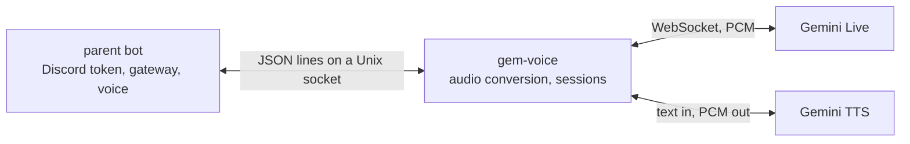

# gem-voice

A voice daemon that lets a Discord bot talk to Gemini. The bot keeps its own Discord token and voice connection and hands Opus audio to the daemon over a Unix socket. The daemon streams it to the Gemini Live API and sends the model's spoken reply back. It can also read plain text aloud with Gemini TTS. It never sees the bot's token.



Here is a session as the parent bot sees it. Each line is one JSON object. Lines with an `id` are requests and replies, and lines with an `event` are pushed by the daemon.

```jsonc
// bot starts a live call
{"id": "1", "action": "join", "owner_user_id": "123456789012345678",
 "persona": {"name": "Bot", "system_prompt": "You are a concise voice assistant."},
 "model_config": {"model": "gemini-3.8-live", "voice": "Aoede", "silence_ms": 700},
 "tools": [{"name": "get_quote", "description": "Latest stock price",
            "parameters": {"type": "object", "properties": {"symbol": {"type": "string"}}}}]}
{"id": "1", "ok": true, "session_id": "sess-9f3a1c02"}

// bot streams 20 ms Opus packets from Discord voice
{"id": "2", "action": "audio_in", "b64": "<opus packet, base64>"}
{"id": "2", "ok": true}

// the model calls a tool mid-turn and the bot answers it
{"event": "tool_call", "call_id": "call-1", "name": "get_quote", "args": {"symbol": "AAPL"}}
{"id": "3", "action": "tool_response", "session_id": "sess-9f3a1c02",
 "call_id": "call-1", "name": "get_quote", "response": {"symbol": "AAPL", "price": 231.40}}
{"id": "3", "ok": true}

// the daemon streams the spoken reply back
{"event": "audio_out", "b64": "<opus packet, base64>"}
{"event": "model_speech_end"}

// text to speech without a live call
{"id": "4", "action": "say", "text": "AAPL is trading at 231 dollars and 40 cents.", "voice": "Aoede"}
{"id": "4", "ok": true}
```

## How it works

**Why a separate process.** The daemon does not join Discord itself. The voice client in discord.py needs too much of the bot's main gateway state to drive from arbitrary credentials, and Node libraries such as `@discordjs/voice` are built for the job. So the parent bot keeps the voice connection and the daemon only deals with audio.

**Live calls.** Audio from Discord is decoded, mixed down to mono and resampled to 16 kHz for the model. The model answers at 24 kHz, and that is resampled to 48 kHz and cut into 20 ms Opus packets. The model's chunks do not end on a packet boundary, so the leftover samples are carried into the next chunk. Dropping them clips syllables. A call can also take JPEG video frames, at most one a second by default.

**Speaking text.** `say` reads text aloud without a live session. The first sentence is synthesized on its own so audio starts quickly. Later sentences are grouped, and a short fragment like "Ok." is joined to its neighbour so it does not cost a call of its own. Chunks are synthesized in parallel and played in order on one 20 ms clock. A short head start fills the parent's jitter buffer. A failed TTS call is tried up to three times before that chunk is skipped.

**Interruptions.** When the speaker talks over the model, Gemini stops generating. The daemon drops the audio it had queued and sends `audio_flush`, so the parent can drop what it has buffered. Without that, the bot would finish its sentence anyway. A new `say` or a `cancel_say` does the same to speech already playing.

**Silence.** The daemon runs no voice detection of its own, because a local detector in front of Gemini's would be a second way to drop speech by mistake. Discord stops sending packets when someone pauses, and the server needs to hear that pause. So the daemon sends silent frames at real-time pace, then an end-of-stream marker after a longer gap.

**Long calls.** Gemini closes a Live WebSocket after a few minutes. The daemon keeps the latest resumption handle the server sends and reconnects with it, so the conversation carries on. The audio queues belong to the session and not the socket, so the gap is short.

**Persona.** Prompts written for a text channel often say when to stay silent. On a call that makes the model say nothing to a greeting or a mic check. On `join` the daemon adds the local date and time, and context from a memory service if you configure one. It then closes the prompt with an instruction that on a call the model always answers aloud. A slow or broken memory service is skipped, so it never holds up a call.

**One client, and a cost cap.** One client connection uses the daemon at a time. A second gets an error and is closed, and the first keeps its session. If the first disconnects, its session and any speech stop. Live sessions are billed by the second, so a watchdog ends a call after five minutes without audio or video, or after thirty minutes in total.

## Protocol

Every request carries an `id` and an `action`.

| Action | Fields | Reply |
|---|---|---|
| `join` | `owner_user_id`, `persona` (`name`, `system_prompt`, optional `memory_query`), optional `model_config`, optional `tools` | `session_id` |
| `leave` | none | `was_active` |
| `status` | none | `active_session`, `uptime_s`, `gemini_connected` |
| `audio_in` | `b64`, a 48 kHz Opus packet | `ok`. Past 200 queued packets the oldest is dropped. |
| `video_in` | `b64`, a JPEG frame | `ok`. The newest frame wins. |
| `tool_response` | `call_id`, `name`, `response`, optional `session_id` | `ok`. A `session_id` that is not the active session is refused. |
| `say` | `text`, optional `voice`, optional `tts_config` | `ok` at once, while audio streams as events |
| `cancel_say` | none | `cancelled` |
| `think` | none | `ok`. It does nothing and is kept so older parents do not get an error. |

`model_config` fields are all optional, and a value out of range rejects the `join` with `bad join payload`:

- `model`, `voice` (default `Aoede`)
- `silence_ms` (100 to 3000, default 700) and `prefix_ms` (0 to 1000, default 100)
- `start_sensitivity` and `end_sensitivity` (`low` or `high`, default `low`)
- `interrupt` (default true)
- `thinking` (`minimal`, `low`, `medium` or `high`, default `minimal`). The model `gemini-3.8-live-extended-thinking` needs more than `minimal`, and `gemini-3.8-live` is sent no thinking setting.
- `temperature` (0 to 2) and `max_tokens` (1 to 8192)

`tts_config` takes a `model` (`gemini-3.8-flash-tts` or `gemini-3.8-flash-lite-tts`) and a `style`, delivery instructions of up to 500 characters.

| Event | Fields | Meaning |
|---|---|---|
| `audio_out` | `b64` | One 20 ms Opus packet to play in the voice channel |
| `audio_flush` | none | Drop everything buffered for playback |
| `tool_call` | `call_id`, `name`, `args` | The model wants a function run. Reply with `tool_response`. |
| `model_speech_end` | none | The model finished its turn |
| `session_ended` | `session_id`, `reason` (`idle_timeout` or `hard_max_duration`), `idle_s` or `duration_s` | The watchdog ended the call |
| `error` | `fatal`, `message` | A send, receive or resumption error |

## Install

You need Python 3.12 or later, the system libopus library (`libopus0` on Debian and Ubuntu), a Gemini API key with Live API access, and a Discord bot to connect it to.

```bash
python3.12 -m venv venv
source venv/bin/activate
pip install -e ".[dev]"
cp .env.example .env   # set GEMINI_API_KEY and DISCORD_OWNER_USER_ID
python -m gem_voice
```

`systemd/gem-voice.service` is an example user service. It caps the daemon at 1 GB of memory and half a CPU.

`scripts/probe_live_models.py`, run from the repo root, tries a short session on every Live-capable model your key can see and reports which ones answer and which hit their quota.

## Configuration

Settings come from the environment and `.env`.

| Variable | Default | Meaning |
|---|---|---|
| `GEMINI_API_KEY` | required | The daemon will not start without it |
| `DISCORD_OWNER_USER_ID` | required | The daemon will not start without it |
| `GEMINI_MODEL` | `gemini-3.8-live` | Live model used when `join` names none |
| `GEMINI_VOICE` | `Aoede` | Voice for `say` when the request names none |
| `IPC_SOCKET_PATH` | `$XDG_RUNTIME_DIR/gem-voice.sock` | Socket path. Falls back to `/tmp/gem-voice.sock`. |
| `LOG_LEVEL` | `INFO` | Log verbosity |
| `MEMORY_STORE_URL` | unset | Memory service. The daemon sends `GET <url>?q=<memory_query>&top_k=5` and expects `{"snippets": [...]}`. |
| `MEMORY_STORE_TIMEOUT_S` | `2.0` | How long to wait for it |
| `GEM_VOICE_IDLE_TIMEOUT_S` | `300` | End a call after this long without audio or video |
| `GEM_VOICE_MAX_DURATION_S` | `1800` | End a call after this long in total |
| `GEM_VOICE_VIDEO` | `0` | Set to `1` for continuous video. It lowers the frame resolution and compresses the context with a sliding window. |
| `GEM_VOICE_VIDEO_FPS` | `1` | Most video frames a second sent to Gemini |
| `GEM_VOICE_VIDEO_QUEUE` | `30` | Video frames held before the oldest is dropped |
| `GEM_VOICE_TTS_MODEL` | `gemini-3.8-flash-tts` | TTS model for `say` |
| `GEM_VOICE_SAY_SYNTH_CONCURRENCY` | `4` | TTS chunks synthesized at once |
| `GEM_VOICE_SAY_LEAD_S` | `0.3` | Head start, in seconds, before `say` settles to real-time pace |

## Tests

```bash
pytest -q -m "not slow"    # unit tests and fake-WebSocket integration tests
pytest -m integration -q   # the integration tests alone
pytest -m slow             # live network tests
```

## License

MIT. See [LICENSE](LICENSE).
